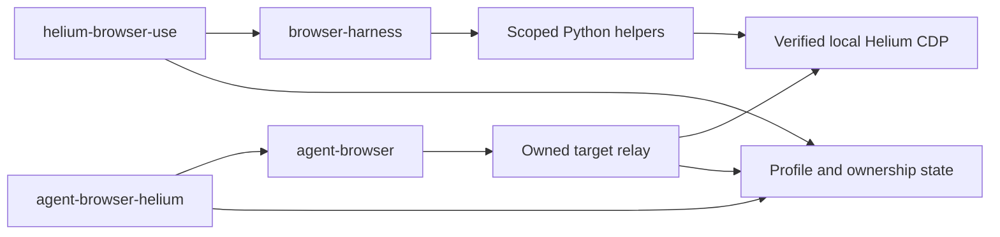

# Architecture

Both entry points use `helium_cdp` for profile lookup, verified creation and
transport, and `helium_session.State` for persistent ownership. The source is in
`src/helium_browser_agent/`.

| Module | Responsibility |
| --- | --- |
| `config.py` | Validated local configuration and workspace matching |
| `helium_controller.py` | Linux process identity and socket-owner verification |
| `helium_cdp.py` | Profiles, context cache, exact-marker creation, bounded CDP transport |
| `helium_session.py` | Ownership lifecycle and scoped Python helpers |
| `cli.py` | Named Python task CLI, harness environment and cleanup |
| `helium_agent.py` | Native CLI parsing, binding, daemon lifecycle and recovery |
| `helium_agent_proxy.py` | Target/session filtering, dialogs and fill compatibility |
| `helium_download.py` | Owned-page HTTP attachment interception and atomic save |
| `tab.py` | Explicit administrative CDP utilities |
| `diagnostics.py` | Read-only endpoint/version checks and profile metadata |

## Invariants

1. An unverified existing browser endpoint never triggers attachment or a second
   browser launch. Socket ownership must match the Helium main process.
2. A session is bound to one profile. Browser generation changes invalidate old
   targets without changing that identity.
3. Register new target ownership before navigation and roll it back on failure.
   Never infer ownership by subtracting global target inventories.
4. Recover only to an owned/new page. Close only owned roots and same-context
   opener descendants. Preserve closed parent IDs for popup attribution.
5. Corrupt/uncertain ownership fails closed. Derived context caches may be rebuilt.
6. Native discovery and attachment are filtered before the backend sees targets.
   Browser-wide mutators, unknown sessions and foreign targets are refused.
7. Cleanup is idempotent, does not provision a missing browser, and retains state
   when it cannot confirm completion.

These protect against accidental cross-tab actions. Raw Python/CDP, same-user
processes, shared cookies/storage and ordinary page-side effects remain outside
that boundary. Explicit administrative `helium-tab` commands can create untracked
tabs or close the browser; prefer task wrappers for automation. No restart CLI or
legacy all-tab controller/MCP surface is distributed with this package.

## Dependency seams

The Python layer binds harness internals to owned CDP sessions. The native adapter
uses agent-browser's socket protocol, `.target` binding format and a recognized
fill function. All are version-sensitive. Upgrade dependencies separately and
run offline plus live regressions before changing supported versions. The relay
is a separate process launched with this package's interpreter and module path.
